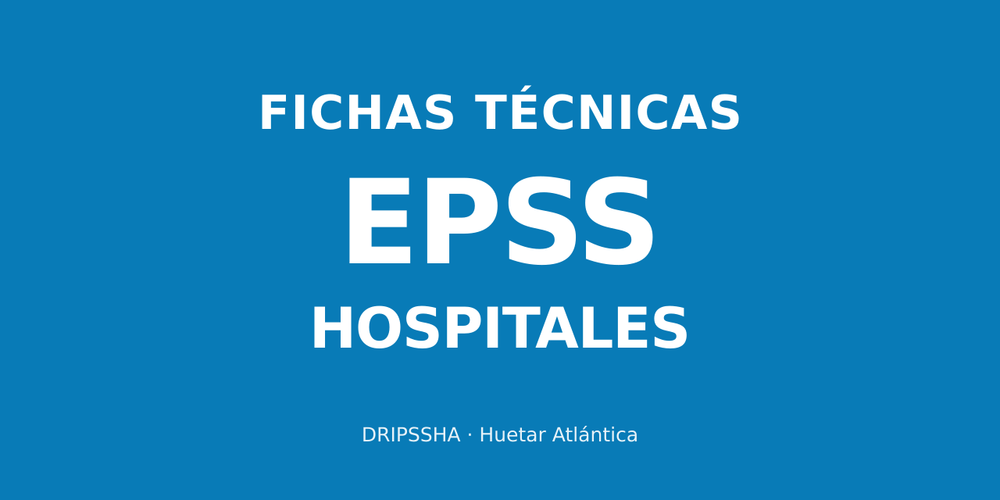

# EPSS a la mano · Hospitales · DRIPSSHA



Aplicación de consulta de fichas técnicas EPSS 2024-2028 con aplicabilidad hospitalaria. Iniciativa de la Dirección de Red Integrada de Prestación de Servicios de Salud Huetar Atlántica. Es independiente de la aplicación de primer nivel y conserva su imagen, navegación, instalación y lectura de documentos.

## Consulta

La entrada abre los indicadores de evaluación. Los complementarios se muestran por separado. El filtro de segundo o tercer nivel orienta la búsqueda y cada ficha conserva el ámbito, los servicios y las condiciones que figuran en su fuente. El filtro no acredita por sí solo la aplicación a un hospital concreto.

Cada ficha dispone de Resumen, Completa (Full) y PDF original. Las familias tienen colores suaves que continúan dentro de la ficha. La sección CIE-10 muestra los códigos explícitos de los documentos, su función y sus indicadores relacionados. La ausencia de códigos en una ficha no se completa por inferencia.

Los favoritos y las consultas recientes se guardan en este dispositivo. La guía de instalación explica cómo agregar la app al inicio de iPhone, Android o al escritorio de una computadora. El visor de PDF tiene regreso a la aplicación y controles de página y zoom. El motor PDF.js se carga al abrir un PDF, conservando sus licencias.

## Evaluación hospitalaria

No se traslada la composición ni la fórmula de la MR del primer nivel a hospitales. Las fuentes hospitalarias reunidas no permiten confirmar una MR hospitalaria. La navegación principal contiene Evaluación y Complementarios. No se presenta una cejilla MR mientras no exista un instrumento hospitalario que la respalde. Los enlaces anteriores a esa cejilla abren Evaluación.

## Identidad y observaciones

Los créditos son institucionales: DRIPSSHA. Las fichas técnicas oficiales se atribuyen a la Dirección Compra de Servicios de Salud de la CCSS. Los reportes de errores o propuestas de mejora se preparan mediante un enlace de correo a msolanoc@ccss.sa.cr; la aplicación no los envía automáticamente.

La línea de versión muestra una fecha y hora fija de publicación en America/Costa_Rica. No es un reloj del dispositivo. La sección Cambios se reserva para modificaciones de las fichas respaldadas documentalmente.

La aplicación no solicita ni registra datos de pacientes. La propiedad de Google Analytics para hospitales es independiente de la de primer nivel.

## Mantenimiento

La aplicación es estática y se sirve desde `dist/`. La identidad de publicación se conserva en `.openai/hosting.json`. El código y los documentos del primer nivel se mantienen en su proyecto independiente.

Antes de publicar, comprobar el catálogo y los documentos, las vistas Resumen y Full, la navegación, el visor PDF y la ausencia de desbordamiento horizontal en teléfono y computadora. La caché y el almacenamiento local usan el prefijo propio `epss-hospitales-dripssha`.

Esta edición reúne 48 fichas: 20 de evaluación y 28 complementarias, con 57 documentos de respaldo. Incluye IAM, gestión hospitalaria, IAAS y las fichas compartidas de anemia, mamografía, eficiencia y bioética cuya aplicación hospitalaria está documentada. El complementario de gasto per cápita de áreas de salud se excluye por contradicción de ámbito.

Las descargas individuales de 12-01 y 12-04 estaban vacías. Ambas se consultan en el PDF íntegro del diseño general, páginas 166–169 y 200–203 respectivamente, con sus anexos. El Resumen identifica este respaldo y la necesidad de cotejo con una descarga individual posterior. Los otros PDF conservan sus bytes y hashes SHA-256. La ficha escaneada 11-02 utiliza la transcripción previamente revisada visualmente.

`data/curacion.json` contiene la revisión documental; `scripts/build-catalog.py` compila el catálogo. El lector conserva todos los caracteres de las 48 fichas y organiza 19 tablas hospitalarias con su contexto de columna, incluidas las continuaciones entre páginas. Las fórmulas ambiguas se conservan sin reconstrucción inferida, con acceso al PDF original.

```sh
python3 scripts/build-catalog.py
python3 scripts/verify-hospital-catalog.py
python3 scripts/verify-hospital-reading.py
node scripts/verify-full-reader.cjs
node scripts/verify-analytics.cjs
node scripts/verify-document-viewer.cjs
node --check dist/app-v2.js
node --check dist/sw.js
```

## Publicación y estadísticas

App: https://9ph9jr6j75-collab.github.io/epss-hospitales/

Repositorio: https://github.com/9ph9jr6j75-collab/epss-hospitales

Propiedad GA4: **EPSS Hospitales · DRIPSSHA**, ID **561176721**, cuenta **408767047**. Flujo web **EPSS a la mano · Hospitales**, ID **16223053761**, etiqueta **G-H0Z84C93TL**. Zona horaria de Costa Rica y moneda CRC. La propiedad es distinta de la del primer nivel. La medición mejorada automática está desactivada; la app envía eventos propios de consulta sin el texto de las búsquedas ni datos de pacientes. Las señales y personalización publicitaria están desactivadas en la etiqueta.

La publicación de GitHub Pages comprueba el catálogo, el lector Full, las tablas y el visor antes de publicar `dist/`. El archivo `.openai/hosting.json` pertenece a la copia de revisión de Sites y no se copia al repositorio de GitHub.

## Datos necesarios para la evaluación

Cada ficha muestra **Qué debe quedar registrado para evaluar este indicador** en ambas formas de lectura. Los CIE-10 son una parte de los datos: los indicadores también utilizan horas, procedimientos, resultados, egresos, estancias, producción, gasto o formularios, según su fuente.

El momento de la acción clínica y el momento en que se documenta pueden ser distintos. La app no ordena digitar horas ni presume que la marca automática de registro demuestra la hora real de aplicación de un medicamento. Los resúmenes remiten al dato y al reporte que exige la ficha. Las órdenes verbales y la documentación posterior no se agregan como excepciones normativas; los PDF y textos Full se conservan íntegros.
